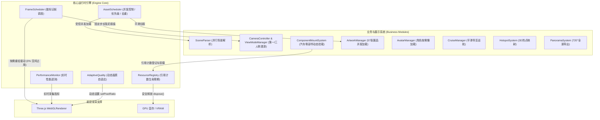

# WebGL 3D Virtual Showroom Engine 🏛️🚗

> **高性能、工业级、模块化 WebGL 3D 虚拟展厅与数字孪生展示运行时**  
> 基于 Three.js 构建，具备完整的资源生命周期治理、脏标记按需渲染、并发加载流水线与工业级性能基准测试体系。

[](LICENSE)
[](https://threejs.org/)
[](https://vitejs.dev/)
[](https://github.com/JunoBarnswell/webGL)

---

## 🌟 核心特性与架构升级

本项目在经过系统化架构重构后，从传统的三维展示原型升级为**面向大型展馆、汽车零件拆解与工业级云展的高性能运行时（High-Performance 3D Runtime）**：

### 1. ⚡ 统一资源并发调度（AssetScheduler）
- **受控并发流水线**：限制网络请求并发度（默认 8 路并发），避免 70+ Mesh 文件同时发起请求导致浏览器网络拥塞与主线程解码暴击。
- **飞行中请求去重（In-flight Deduplication）**：同 URL 并发请求自动共享同一 Promise，消除了重复下载。
- **优先级队列调度**：碰撞体（Collision）与地面（Floor）优先调度，装饰品与远景资源平滑加载。
- **瞬时骨架生成**：场景解析（`SceneParser`）0ms 同步构建层级与变换矩阵，Geometry 与 Material 异步并发装配上屏。

### 2. 🎯 脏标记按需渲染与帧调度（FrameScheduler）
- **模拟推进与渲染解耦**：将输入检测、碰撞推导、动画混合器与 WebGL 渲染管线解耦。
- **自动休眠模式（On-demand Idle）**：当角色静止、镜头无旋转且无动画播放时，连续 3 帧后自动挂起渲染，**GPU 负载与 CPU 占用降至接近 0%**，大幅延长移动设备与笔记本电池续航。
- **事件驱动动态唤醒**：按键、鼠标拖拽、滚轮滑动、窗口 Resize 瞬时唤醒 60/120Hz 全速渲染。
- **帧率无关平滑插值（Exponential Decay）**：在 60Hz、120Hz、144Hz 等不同高刷屏上保持完全一致的物理阻尼手感，消除屏幕差异导致的抖动。

### 3. 🛡️ 资源生命周期治理与安全引用（ResourceRegistry）
- **引用计数（Reference Counting）**：统一托管几何体（Geometry）、材质（Material）与纹理（Texture）。
- **杜绝误销毁崩溃**：修复 GLTF 克隆实例卸载时共享资源被提前 `dispose()` 的架构隐患。
- **全链路深度释放**：`ShowroomEngine.dispose()` 深度遍历释放场景树所有 GPU 显存，10 轮以上连续组件挂载/卸载保持 **0 显存泄漏**。

### 4. 🚀 关键业务能力与展示系统
- **第一/第三人称平滑漫游**：
  - **第三人称 SpringArm 弹簧臂**：基于射线碰撞的主动防穿墙遮挡检测。
  - **第一人称视线解耦**：角色水平转向与鼠标仰俯角度解耦。
- **Avatar 角色按需懒加载**：
  - 首屏无需等待 2.93MB 角色模型，极速呈现展厅第一人称视角；
  - 仅在用户按 `V` 键切换第三人称时按需拉取并平滑唤醒动画状态机（Idle / Walk / Run）。
- **汽车零部件动态装配/拆解挂载（ComponentMountSystem）**：
  - 支持按需挂载 glTF/GLB 零部件，支持独立零部件装配/拆解动画驱动与分层控制。
- **艺术品画框受控加载（ArtworkManager）**：
  - 4 路受控并发加载 57 张作品高清贴图，点击画作弹出高分辨率导览详情。
- **无卡顿巡航导览（CruiseManager）**：
  - 消除传统多段插值折角停顿，采用余弦速度平滑包络（Cosine Velocity Envelope）实现电影级平滑运镜。
- **720° 全景图导出（PanoramaSystem）**：
  - 支持将当前视点一键离屏渲染并导出 720° 立方体与等距柱状全景图。
- **自适应画质调节（AdaptiveQuality）**：
  - 连续掉帧时自适应降级 Pixel Ratio 保障帧率，负载恢复后平滑回弹。
- **实时遥测看板（PerformanceMonitor）**：
  - 实时统计 Draw Calls、Triangles、FPS、P50 / P95 / P99 帧耗时与显存对象，按 `F2` 或 `~` 键快速切换。

---

## 🏗️ 架构拓扑图



---

## 📂 项目结构

```
webgl-virtual-showroom/
├── packages/
│   └── engine/                    # 引擎核心 SDK
│       ├── core/                  # 运行时核心模块
│       │   ├── ShowroomEngine.js  # 统一门面 Facade
│       │   ├── FrameScheduler.js  # 帧调度器与脏标记系统 (按需渲染)
│       │   ├── ResourceRegistry.js# 资源注册表与引用计数管理
│       │   ├── PerformanceMonitor.js # 实时遥测 HUD (Draw Call, P95, 内存)
│       │   ├── AdaptiveQuality.js # 自适应分辨率调节
│       │   ├── RenderLoop.js      # 基础渲染循环接口 (兼容层)
│       │   ├── EventEmitter.js    # 引擎事件总线
│       │   └── MathUtils.js       # 帧率无关数学工具函数
│       ├── loader/                # 资源加载流水线
│       │   ├── AssetScheduler.js  # 并发任务池、去重与优先级调度器
│       │   ├── SceneParser.js     # 8路并发场景解析流水线
│       │   ├── O2vrMeshLoader.js  # O2VR Mesh 二进制解析与缓存
│       │   └── BaseMeshLoader.js  # 基础网格加载抽象类
│       ├── controls/              # 漫游与相机控制
│       │   ├── CameraController.js# 漫游移动、数学对象复用、状态驱动地面检测
│       │   ├── ViewModeManager.js # 第一/第三人称切换、SpringArm 防穿墙
│       │   ├── CollisionSystem.js # 场景碰撞边界检测
│       │   └── DisplayModeController.js # 展区分层控制
│       ├── business/              # 业务特色功能
│       │   ├── ComponentMountSystem.js # 零部件/汽车模型动态挂载
│       │   ├── CruiseManager.js   # 平滑巡航漫游导览
│       │   ├── ArtworkManager.js  # 艺术品贴图并发挂载
│       │   ├── HotspotSystem.js   # 3D 空间热点投影
│       │   ├── PanoramaSystem.js  # 720° 全景图导出
│       │   ├── ZoneGuideManager.js# 展区飞跃跳转 (flyTo)
│       │   └── AudioSystem.js     # 空间音效与背景音乐
│       ├── avatar/                # 虚拟角色系统
│       │   └── AvatarManager.js   # 人形角色模型骨骼动画与按需懒加载
│       └── material/              # 材质与光照贴图
│           ├── LightmapManager.js # 烘焙光照贴图缓存与通道映射
│           ├── MaterialFactory.js # 材质生成工厂
│           └── EnvironmentMap.js  # 环境反射贴图
├── public/                        # 静态场景资源与模型数据
│   ├── model/showroom/            # 展厅 scene.json 与 70 个 .mesh 资源
│   ├── model/avatar/              # 角色 GLB 模型
│   └── artworks/                  # 作品 manifest.json 与贴图数据
├── src/                           # 展厅前端演示应用 (UI & Components)
│   ├── components/                # 导览条、巡航开关、视角切换弹窗等 UI
│   ├── main.js                    # 展厅初始化与业务挂载
│   └── style.css                  # 现代化毛玻璃深色主题样式
├── test/                          # 性能回归与自动化测试套件
│   └── benchmark.js               # 并发去重、引用计数与物理阻尼基准测试
├── benchmark.html                 # 浏览器端性能基准回归测试可视化页面
├── index.html                     # 主应用入口
└── package.json
```

---

## 🚀 快速开始

### 运行环境
- Node.js >= 18.0.0
- 支持 WebGL 2.0 的现代浏览器（Chrome、Edge、Firefox、Safari）

### 安装与启动
```bash
# 1. 克隆仓库
git clone https://github.com/JunoBarnswell/webGL.git
cd webGL

# 2. 安装依赖
npm install

# 3. 启动开发服务器
npm run dev

# 4. 生产打包构建
npm run build

# 5. 本地预览生产产物
npm run preview
```

---

## 🧪 自动化性能基准测试

项目中配置了严谨的性能回归基准套件，可通过以下命令一键运行：

```bash
npm run test:benchmark
```

### 测试涵盖项目：
1. **AssetScheduler 并发度与去重测试**：
   - 压测 50 次并发请求，验证是否精准去重为 20 次实际网络加载，吞吐耗时稳定在 80ms 以内。
2. **ResourceRegistry 引用计数生命周期测试**：
   - 验证多实例共享几何体时，引用未归零绝不触发 `dispose()`；
   - 压测 5000 次高频注册与清空显存耗时（< 4ms）。
3. **FrameScheduler 高刷阻尼一致性测试**：
   - 模拟 60Hz 与 144Hz 屏幕在相同阻尼系数下的累计插值误差，严格保证数值一致（误差 < 1e-4）。

### 浏览器端可视化基准测试
启动 `npm run dev` 后，直接在浏览器中打开 `http://localhost:5173/benchmark.html`，可一键评估：
- **首屏场景解析真实耗时**（SceneParser 耗时）；
- **实时 Draw Calls 与三角面数**；
- **静止休眠状态检测**（验证空闲状态下 GPU 渲染暂停）；
- **10 轮连续动态组件挂载与卸载显存泄漏检测**（验证 Geometries 增量为 0）；
- **P50 / P95 实时帧耗时分布**。

---

## 🎮 操作指南

| 操作 / 快捷键 | 功能描述 |
| :--- | :--- |
| **`W / A / S / D`** | 角色前后左右移动漫游 |
| **`Shift` + 移动** | 加速冲刺奔跑 (Sprint) |
| **鼠标左键拖拽** | 调整镜头视角方向（视线俯仰 ±79° 限位） |
| **`V` 键** | 切换**第一人称视角** / **第三人称视角**（首次切换触发 Avatar 懒加载） |
| **`F2` 或 `~` 键** | 唤起 / 隐藏左上角**引擎实时性能遥测面板 (HUD)** |
| **点击画框艺术品** | 聚焦艺术品并弹出高清详情弹窗 |
| **右侧控制条** | 开启自动平滑巡航导览、视角跳转、背景音乐控制、720°全景截图导出 |

---

## 💻 核心 API 使用示例

### 1. 初始化引擎
```javascript
import { ShowroomEngine } from './packages/engine/index.js';

const engine = new ShowroomEngine({
  container: document.getElementById('webgl-container'),
  fov: 60,
  maxDistance: 35000,
  collision: true,
  onDemand: true,       // 开启按需重绘，静止时休眠省电
  showPerf: true,       // 显示性能遥测看板 (F2切换)
  adaptiveQuality: true // 开启自适应分辨率防掉帧
});

// 加载展厅场景、作品清单与按需角色
await engine.loadScene({
  sceneUrl: '/model/showroom/scene.json',
  baseUrl: '/model/showroom',
  manifestUrl: '/artworks/manifest.json',
  avatarUrl: '/model/avatar/character.glb'
});
```

### 2. 动态挂载零部件（支持引用计数与动画）
```javascript
// 挂载动态汽车轮毂零件
const wheel = await engine.mountComponent({
  id: 'front_wheel_left',
  url: '/model/components/wheel.glb',
  position: { x: 1200, y: 350, z: -800 },
  autoPlayAnimation: true
});

// 触发装配动画
engine.playComponentAnimation('front_wheel_left', 0);

// 安全卸载（引用计数归还，不误杀共享材质）
engine.unmountComponent('front_wheel_left');
```

### 3. 获取实时性能指标
```javascript
const metrics = engine.perfMonitor.getMetrics();
console.log(`FPS: ${metrics.fps}, P95: ${metrics.p95}ms, DrawCalls: ${metrics.drawCalls}`);
```

### 4. 深度释放与销毁
```javascript
// 彻底清理场景、卸载监听、清空显存缓存（SPA 页面离开时调用）
engine.dispose();
```

---

## 📄 开源许可证

本项目基于 [MIT License](LICENSE) 开源协议发布。
