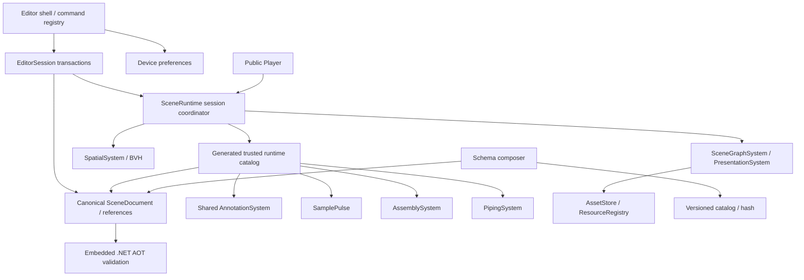

# Studio 2 implementation design

Baseline: 0c3ae97da282e843efb490589215c2a8fca51d07 (latest origin/main inspected).

The scene document is the only authoring model. EditorSession owns all document changes and undo. Device preferences own dock visibility, layout density and key bindings. A preview changes only the existing runtime session; the Canvas and camera survive layout changes.

Trusted, statically composed extension schemas are the shared contract source for Inspector, reference scanning, TS validation and the embedded AOT validator. Missing extensions preserve JSON during authoring and block publication. Migration occurs at open/import boundaries, never per frame. Published versions remain immutable.

Runtime systems own their instances and disposable effects. Action dispatch uses registered handlers. Systems receive indexed changes and the existing frame scheduler; no additional RAF, dynamic scripts, duplicate runtime or industry branches in the core dispatcher. Annotation projection is shared by showroom and industry labels. Assembly derives overlays from immutable baseline poses, and piping indexes logical lines separately from physical segments.

Implementation order: command/layout ownership, extension contract and sample, shared annotations, then domain extensions. Verification is consolidated after implementation as requested by the user. Gate evidence must be reported honestly; no unexecuted integration or performance result counts as a pass.

## Ownership and dependencies

Graph/material services retain existing asset, hierarchy, animation and media semantics instead of copying the old runtime. Camera navigation and tours retain their existing implementations. The coordinator serializes changes, checks scene generations and owns session cancellation. Logical pipeline identity never substitutes for segment or model-node identity.

The editor-only preference store and helper overlays do not enter SceneDocument, undo history or published manifests. All industry transforms are runtime overlays; source transforms remain authoritative. Labels share projection, occlusion and screen-space clustering with showroom hotspots.

## Advanced authoring through the same contracts

Extension panels receive the document, selection, runtime snapshot, command, dispatch, inspect and placement capabilities. They are statically composed beside tools; the shell does not select panels by industry name. Generic Inspector arrays retain stage identity when reordered, and all spatial points use `DocumentPath` selectors and one transform gizmo. The same editor services edit tour viewpoints, assembly paths and annotation positions.

Assembly BOM/group/step authoring, piping system/line assignment and typed CSV mapping, and annotation repair/bulk editing all create EditorSession transactions. A shared VisualStateSystem owns temporary materials and isolation, including restoration of the current assembly visibility state. Player action controls select one target per action rather than generating an entire panel for each part; related step options and public property fields come from schema metadata.

Model revision reconciles stable source identity and hierarchy before committing. Removing or renaming a source element cannot silently discard business identity. Surface anchors deliberately require user reselection when triangle provenance changes. Unresolved source placeholders and missing action steps are validated by both TypeScript and embedded Native AOT contracts.
